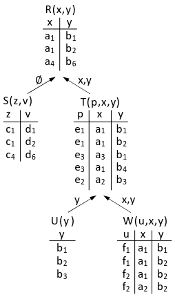

<!-- _class: title -->
# Hypergraphes acycliques et résolution de contraintes 


---
<!-- _class: agenda -->
1. Introduction
2. Aspect théorique
2. Algorithmes
5. Implémentation finale
6. Résultats expérimentaux
7. Conclusion


---
<!--_class: chapter -->
# Introduction


---
<!-- _class: grid-tlr -->
# Graphes et acyclicité

<div class="glft">

**Graphe cyclique**


**Liste d'adjacence**
```yaml
A : B, F
B : A, C, D, G
C : B, E
D : B, I
...
```
</div><div class="grgt">

**Graphe acyclique**


**Liste d'adjacence**
```yaml
5 : 1
1 : 0, 5
0 : 1, 2
2 : 0, 3, 4
...
```
</div><div class="gtop">
</div>


---
<!-- _class: grid-tlr -->
# Hypergraphes

<div class="glft">

**Hypergraphe**


**Liste d'adjacence**
```yaml
Vert : 0, 1
Rouge : 1, 2, 3
Jaune : 4
```
</div><div class="grgt">

**Définition**
Soit $X = \{ v_0, v_1, ..., v_n \}$ un ensemble fini.
Un hypergraphe sur $X$ est une famille $H = (E_0, E_2, ..., E_p)$ de parties de $X$ vérifiant
$$ E_i \neq \emptyset \text{ pour } i = 0, 1, ..., p $$
Et
$$ \bigcup_{i=0}^p E_i  = X $$
</div><div class="gtop">
</div>


---
<!-- _class: grid-tlr -->
# Structure d'hypergraphe

<div class="glft">

```py
class Arete:
    cardinal: int
    field: int
    indice: int

class Hyper:
    aretes: List[Arete]
    ordre: int
```

</div><div class="grgt">

```py
class Arete:
    def sommets(self)
    def copier(self)
    def augmenter(self, sommet: int)
    def reduire(self, sommet: int)
    def dans(self, sommet: int)
    def contient(self, arete: Arete)

class Hyper:
    def nb_aretes(self)
    def decompte(self, sommet: int)
    def est_valide(self)
    def retirer_sommet(self, sommet: int)
    def copier(self)
    def ajouter_arere(self, arete: Arete)
    def enlever_arete(self, arete: int)
```

</div><div class="gtop">

On se munit de fonctions auxiliaires pour manipuler les hypergraphes.

</div>


---
# Base de données
On va s'intéresser au schéma suivant :

```sql
CREATE TABLE communes (
    INT id PRIMARY KEY,
    INT region,
    INT departement,
    CHAR nom
)

CREATE TABLE departements (
    INT id PRIMARY KEY,
    INT region,
    CHAR nom
)

CREATE TABLE regions (
    INT id PRIMARY KEY,
    INT cheflieu,
    CHAR nom
)
```

---
<!-- _class: grid-tlr -->
# Base de données

<div class="glft">

**Communes**
|Identifiant|Région|Département|Nom|
|-|-|-|-|
|75056|11|75|Paris|
|29019|53|29|Brest|
|69123|84|69|Lyon|

</div><div class="grgt">


**Régions et départements**
|Identifiant|Cheflieu|Nom|
|-|-|-|
|11|75056|Île-de-France|
|53|35238|Bretagne|
|84|69123|Auvergne-Rhône-Alpes|

|Identifiant|Région|Nom|
|-|-|-|
|75|11|Paris|
|29|53|Finistère|
|69|84|Rhône|

</div><div class="gtop">
</div>


---
<!-- _class: chapter -->
# Aspect théorique


---
# Algèbre relationnelle

$$ \text{rel}(a_1: dom_1, ..., a_n : dom_n) $$

**Exemple**
$$ \text{commune}(\text{identifiant}: \text{entier}, \text{ departement}: \text{entier}, \text{ region}: \text{entier}, \text{ nom}: \text{texte}) $$

**n-uplets**
- P = commune(75056, 11, 75, Paris)
- B = commune(29019, 53, 29, Brest)
- L = commune(69123, 84, 69, Lyon)

$$ I = \{ P, B, L \} $$

---
# Requête conjonctive

$$ q(x_1, ..., x_n) :- R_1(\vec{y_1}), ..., R_p  (\vec{y_p}) $$

**Exemple**
- Schéma
$$ \text{commune}(\text{nom} : \text{texte}, \text{departement}: \text{entier}) $$
$$ \text{departement}(\text{numero}: \text{entier}, \text{ nom}:\text{texte}, \text{ region}:\text{texte}) $$
- Requête
$$  q_1(c, d, r) :- \text{commune}(c, x),\text{departement}(x, d, r) $$


---
# Hypergraphe d'une requête

**Définition**
$$ q(x_1, ..., x_n) :- R_1(\vec{y_1}), ..., R_p  (\vec{y_p}) $$

- $V = \{x_1, ..., x_n\}$
- les arêtes sont les variables apparaissant dans chacune des clauses atomiques

$$ E_i = V \cap \text{var}(\vec{y_i}) $$

**Exemple**
$$ q(v_0, v_1, v_2, v_3, v_4)  :- R_\text{vert} (v_0, v_1), R_\text{rouge} (v_1, v_2, v_3), R_\text{jaune} (v_3, v_4) $$

<center>
    
</center>

---
<!-- _class: grid-tlr -->
# Arbres de jointure

<div class="glft">

<center>
    
</center>

</div><div class="grgt">

<center>
    
</center>

</div><div class="gtop">

**Définition**
Soit $H$ un hypergraphe sur $X$, et $T$ un graphe ayant pour sommet les arêtes de $H$.
$T$ est un arbre de jointure si
- pour tout sommet $v$ de $H$, le sous-graphe de $T$ engendré par l'ensemble des sommets de $T$ contenant $v$ est connexe
- $T$ est un arbre


Un tel hypergraphe est dit $\alpha$-acyclique.

</div>

---
# Arbres  de jointure


---
<!-- _class: chapter -->
# Algorithmes


---
<!-- _class: grid-tlr -->
# Réduction Graham-Yu-Ozsoyoglu

<div class="glft">

Pour déterminer si unhypergraphe est $\alpha$-acyclique.

**Entrée :** hypergraphe $H$
**Sortie :** booléen indiquant si $H$ est acyclique

- **Tant que** $H$ a une oreille **faire**
    - $e$ oreille de $H$
    - retirer tous les sommets exclusivement dans $e$
    - retirer $e$
- **Fin**
- **Renvoyer** $H$ est l'hypergraphe vide

</div><div class="grgt">

```py
def est_acyclique(self):
    h = self.copier()
    restant = set(range(h.ordre))
    sommets_compte = [h.decompte(s) for s in range(h.ordre)]

    while True:
        sortir = True

        # On enlève tous les sommets isolés
        for s in restant:
            if sommets_compte[s] <= 1:
                restant.discard(s)
                h.retirer_sommet(s)
                sortir = False
        
        # On enlève toutes les arêtes inclues dans d'autre
        for indice, a in enumerate(h.aretes):
            for b in h.aretes:
                if a.dans(b) and a.indice != b.indice:
                    for s in a.sommets:
                        sommets_compte[s] -= 1
                    h.enlever_arete(indice)
                    sortir = False
                    break
        
        # On continue éventuellement l'algorithme
        if sortir or len(restant) == 0:
            break

    return len(restant) == 0
```

</div><div class="gtop">

</div>


---
<!-- _class: grid-tlr -->
# Construction de l'arbre de jointure

<div class="glft">

Il suffit de reprendre l'algorithme précédent, en rajoutant des arêtes au fur et à mesure que des arêtes sont inclues dans d'autres.

</div><div class="grgt">

```py
def est_acyclique(self):
    arbre = [[] for _ in range(self.nb_aretes)]

    # [...]

    while True:
        # [...]
        
        # On enlève toutes les arêtes inclues 
        for indice, a in enumerate(h.aretes):
            for b in h.aretes:
                if a.dans(b) and a.indice != b.indice:
                    arbre[a.indice].append(b.indice)
                    arbre[b.indice].append(a.indice)
                    # [...]
        
        # [...]

    return arbre if len(restant) == 0 else None
```

</div><div class="gtop">

</div>


---
<!-- _class: grid-tlr -->
# Algorithme de Yannakakis

<div class="glft">

- **Entrée :** une requête conjonctive $q$, une instance $I$
- **Sortie :** $q(I)$
- $T \leftarrow$ arbre de jointure de $q$ avec une racine
- $J \leftarrow$ instance réduite issue de $I$
- $R_1, ..., R_n \leftarrow$ parcours postfixe de $T$
- **Pour** $i = 1, ..., n$ **faire**
  - $S_1, ..., S_k$ enfants de $R_i$ dans $T$
  - **Pour** $j = 1, ..., k$ **faire**
    - $R_i^J \leftarrow \pi_{\text{vars}(R_i) \cup \text{head}(q)} (R_i^J \bowtie S_j^J)$
  - **Fin**
- **Fin**

</div><div class="grgt">

<center>



</center>

</div><div class="gtop">


</div>


---
<!--  _class: chapter -->
# Implémentation


---
<!-- _class: grid-lrb -->
# Construction de la base de données


<div class="glft">

```py
class Table:
    name: str
    rows: List[tuple]
    columns: List[str]

    def len(self)
    def import_from(self, csv_path: str)
    def export_to(self, csv_path: str)
    def project(self, selection: List[bool], validate)
```


</div><div class="grgt">

```py
class Instance:
    tables: dict[str, Table]

    def add_table(self, table: Table)
    def jointure(self, query: Query)

    def bottom_up(self, query: Query, node: JoinNode)
    def top_down(self, query: Query, node: JoinNode)
    def query(self, Query)
```

</div><div class="gbot">

```py
i = Instance()

communes = Table("commune")
communes.import_from("code/data/v_commune_2025.csv")

i.add_table(communes)
```


</div>


---
# Requête

Construction inductive d'une requête

```py
nom_com = "nom_com"
nom_dep = "nom_dep"
nom_reg = "nom_reg"
num_dep = "num_dep"
num_reg = "num_reg"

_ = "_"

r = Query(
    Head("requête", nom_com, nom_dep, nom_reg),
    Atom("commune", _, _, num_reg, num_dep, _, _, _, _, _, nom_com, _, _),
    Atom("département", num_dep, _, _, _, _, _, nom_dep),
    Atom("région", num_reg, _, _, _, _, nom_reg),
)
```


---
# Réalisation d'une requête
```py
# Réalisation d'une requête
def query(self, query: Query):

    # Vérification de la requête
    for atom in query.atoms:
        if atom.name not in self.tables:
            raise InterruptedError(atom.name + " non présent dans les tables.")
        if len(atom.original) != len(self.tables[atom.name].columns):
            raise InterruptedError("Nombre de colonnes non correspondant dans la table " + atom.name)

    # Création de l'arbre de jointure
    jointree = self.jointure(query)

    # Premier passage
    self.bottom_up(query, jointree)

    # Deuxième passage
    self.top_down(query, jointree)

    # On réalise la jointure
    jointree.compute(query.head)

    return jointree.table
```


---
<!-- _class: chapter -->
# Résultats expérimentaux


---
# Exemple de requête
## Commune, département, région
```sql
SELECT commune.nom, departement.nom, region.nom FROM commune
JOIN departement ON departement.numero = commune.departement
JOIN region ON region.numero = commune.region
```

```py
Query(
    Head("requête", nom_com, nom_dep, nom_reg),
    Atom("commune", _, _, num_reg, num_dep, _, _, _, _, _, nom_com, _, _),
    Atom("département", num_dep, _, _, _, _, _, nom_dep),
    Atom("région", num_reg, _, _, _, _, nom_reg),
)
```

**Résultats :**
- Version simple : 0.17 secondes
- Version double parcours : 0.08 secondes


---
# Exemple de requête
## Commune, cheflieu
```sql
SELECT commune.nom, departement.nom, fheflieu.nom FROM commune
JOIN departement ON departement.numero = commune.departement
JOIN commune as cheflieu ON commune.numero = departement.cheflieu
```

```py
Query(
    Head("requête", nom_com, nom_cheflieu),
    Atom("commune", _, _, _, num_dep, _, _, _, _, _, nom_com, _, _),
    Atom("département", num_dep, _, num_cheflieu, _, _, _, _),
    Atom("commune", _, num_cheflieu, _, _, _, _, _, _, _, nom_cheflieu, _, _)
)
```

**Résultats :**
- Version simple : 0.09 secondes
- Version double parcours : 0.06 secondes


---
# Enchaînement requêtes

Le temps pris reste consistant pour des batch de requêtes.


---
<!-- _class: chapter -->
# Conclusion


---
# Conclusion
- On peut étendre aisément la structure de requête pour ajouter des conditions sur les valeurs
- Ne pas copier les valeurs directement, mais des pointeurs vers les valeurs de la table (indices), pour consommer moins de mémoire (gains de performance aussi ?)
- On peut le programmer en C, Rust pour de meilleurs performances, et une gestion de la mémoire plus délicate
- La constante est assez élevée, dans la pratique ce n'est pas l'algorithme qui est toujours utilisé.