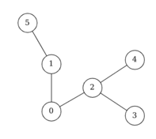

<!-- _class: title -->
# Hypergraphes acycliques et résolution de contraintes 


---
<!-- _class: agenda -->
1. Introduction
2. Aspect théorique
2. Algorithmes
5. Implémentation finale
6. Résultats expérimentaux
7. Conclusion


---
<!--_class: chapter -->
# Introduction


---
<!-- _class: grid-tlr -->
# Graphes et acyclicité

<div class="glft">

**Graphe cyclique**


**Liste d'adjacence**
```yaml
A : B, F
B : A, C, D, G
C : B, E
D : B, I
...
```
</div><div class="grgt">

**Graphe acyclique**


**Liste d'adjacence**
```yaml
5 : 1
1 : 0, 5
0 : 1, 2
2 : 0, 3, 4
...
```
</div><div class="gtop">
</div>


---
<!-- _class: grid-tlr -->
# Hypergraphes

<div class="glft">

**Hypergraphe**


**Liste d'adjacence**
```yaml
Vert : 0, 1
Rouge : 1, 2, 3
Jaune : 4
```
</div><div class="grgt">

**Définition**
Soit $X = \{ v_0, v_1, ..., v_n \}$ un ensemble fini.
Un hypergraphe sur $X$ est une famille $H = (E_0, E_2, ..., E_p)$ de parties de $X$ vérifiant
$$ E_i \neq \emptyset \text{ pour } i = 0, 1, ..., p $$
Et
$$ \bigcup_{i=0}^p E_i  = X $$
</div><div class="gtop">
</div>


---
<!-- _class: grid-tlr -->
# Structure d'hypergraphe

<div class="glft">

```c
typedef struct arete {
    int cardinal;
    int* sommets;
} arete;

typedef struct hyper {
    int ordre;
    int nb_aretes;
    arete** aretes;
} hyper;
```

</div><div class="grgt">

```c
arete* creer_arete(int cardinal);
void liberer_arete(arete* a);
arete* copier_arete(arete* a);
void augmenter_arete(arete* a, int sommet);
void reduire_arete(arete* a, int sommet);
bool dans_arete(arete* a, int sommet);

hyper* creer_hyper(int ordre, bool strict);
bool est_valide(hyper* h);
void ajouter_arete(hyper* h, arete* a);
void enlever_arete(hyper* h, int indice);
```

</div><div class="gtop">

On se munit de fonctions auxiliaires pour manipuler les hypergraphes.

</div>


---
# Base de données
On va s'intéresser au schéma suivant :

```sql
CREATE TABLE communes (
    INT id PRIMARY KEY,
    INT region,
    INT departement,
    CHAR nom
)

CREATE TABLE departements (
    INT id PRIMARY KEY,
    INT region,
    CHAR nom
)

CREATE TABLE regions (
    INT id PRIMARY KEY,
    INT cheflieu,
    CHAR nom
)
```

---
<!-- _class: grid-tlr -->
# Base de données

<div class="glft">

**Communes**
|Identifiant|Région|Département|Nom|
|-|-|-|-|
|75056|11|75|Paris|
|29019|53|29|Brest|
|69123|84|69|Lyon|

</div><div class="grgt">


**Régions et départements**
|Identifiant|Cheflieu|Nom|
|-|-|-|
|11|75056|Île-de-France|
|53|35238|Bretagne|
|84|69123|Auvergne-Rhône-Alpes|

|Identifiant|Région|Nom|
|-|-|-|
|75|11|Paris|
|29|53|Finistère|
|69|84|Rhône|

</div><div class="gtop">
</div>


---
<!-- _class: chapter -->
# Aspect théorique


---
# Algèbre relationnelle

$$ \text{rel}(a_1: dom_1, ..., a_n : dom_n) $$

**Exemple**
$$ \text{commune}(\text{identifiant}: \text{entier}, \text{ departement}: \text{entier}, \text{ region}: \text{entier}, \text{ nom}: \text{texte}) $$

**n-uplets**
- P = commune(75056, 11, 75, Paris)
- B = commune(29019, 53, 29, Brest)
- L = commune(69123, 84, 69, Lyon)

$$ I = \{ P, B, L \} $$

---
# Requête conjonctive

$$ q(x_1, ..., x_n) :- R_1(\vec{y_1}), ..., R_p  (\vec{y_p}) $$

**Exemple**
- Schéma
$$ \text{commune}(\text{nom} : \text{texte}, \text{departement}: \text{entier}) $$
$$ \text{departement}(\text{numero}: \text{entier}, \text{ nom}:\text{texte}, \text{ region}:\text{texte}) $$
- Requête
$$  q_1(c, d, r) :- \text{commune}(c, x),\text{departement}(x, d, r) $$


---
# Arbres de jointure

**Définition**
Lorem ipsum dolor sit amet.


---
<!-- _class: chapter -->
# Algorithmes


---
# Réduction Graham-Yu-Ozsoyoglu


---
# Algorithme de Yannakakis


---
<!--  _class: chapter -->
# Implémentation


---
<!-- _class: chapter -->
# Résultats expérimentaux


---
# Résultats expérimentaux


---
<!-- _class: chapter -->
# Conclusion