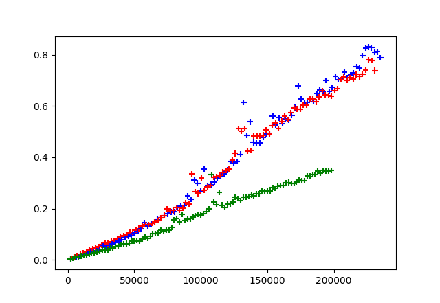

<!-- _class: title -->
# Calcul de requêtes dans une base de données


---
<!-- _class: agenda -->
1. Requêtes conjonctives
2. Algorithme de Yannakakis
3. Résultats
4. Conclusion


---
<!--_class: chapter -->
# Requêtes conjonctives


---
<!-- _class: grid-tlr -->
# Base de données

<div class="glft">


```sql
CREATE TABLE commune (
    INT id PRIMARY KEY,
    INT departement,
    CHAR nom
)

```

</div><div class="grgt">

|Identifiant|Département|Nom|
|-|-|-|
|1|75|Paris|
|2|29|Brest|
|3|69|Lyon|

</div><div class="gtop">
</div>


---
# Requête conjonctive

$$ q(\text{c.nom}, \text{d.nom}) :- \text{commune}(\text{c.id}, \text{c.nom}, \text{d.id}), \text{dep}(\text{d.id}, \text{d.nom}) $$

**Requête conjonctive**
```sql
SELECT c.nom, d.nom
FROM commune AS c
JOIN departement AS d ON c.departement = d.id
```

<!-- where manière la plus simple de rendre une requête non conjonctive -->
**Requête non conjonctive**
```sql
SELECT c.nom, d.nom
FROM commune AS c
JOIN departement AS d ON c.departement = d.id
WHERE c.nom LIKE "Le %"
```


---
# Requête conjonctive acyclique

**Requête conjonctive acyclique**
```sql
SELECT c.nom, d.nom, r.nom
FROM commune AS c
JOIN departement AS d ON c.departement = d.id
JOIN region AS r ON d.region = r.id
```

**Requête conjonctive cyclique**
```sql
SELECT c.nom, d.nom, r.nom
FROM commune AS c
JOIN departement AS d ON c.departement = d.id
JOIN region AS r ON d.region = r.id AND c.region = r.id
```

<center>
    
</center>


---
<!-- _class: chapter -->
# Algorithme de Yannakakis


---
# Algorithme naïf

On fait un produit cartésien.

<!-- Vide pour alléger. Numéros à côté pour voir la correspondance -->
|commune.id|commune.nom|commune.departement|departement.id|departement.nom|
|-|-|-|-|-|
|1|Paris|75|75|Île-de-France|
||||29|Finistère|
||||80|Somme|
|2|Brest|29|75|Île-de-France|
||||29|Finistère|
||||80|Somme|
|3|Lyon|69|75|Île-de-France|
||||29|Finistère|
||||80|Somme|


---
<!-- _class: grid-tlr -->
# Arbre de jointure

<div class="glft">

**Exemple**
```sql
SELECT c.nom, d.nom, r.nom
FROM commune AS c
JOIN departement AS d ON c.departement = d.id
JOIN region AS r ON d.region = r.id
```

</div><div class="grgt">

<center>
    
</center>

</div><div class="gtop">

**Définition : arbre de jointure d'une requête**
Graphe $T$ vérifiant
- les sommets de $T$ sont les relations de la requête
- le sous-graphe induit par les relations contenant une même variable partagée est connexe
- $T$ est un arbre

</div>


---
<!-- _class: grid-tlr -->
# Algorithme de Yannakakis

<div class="glft">

- **Entrée :** une requête conjonctive $q$, une instance $I$
- **Sortie :** $q(I)$
- $T \leftarrow$ arbre de jointure de $q$ avec une racine
- $J \leftarrow$ instance réduite issue de $I$
- $R_1, ..., R_n \leftarrow$ parcours postfixe de $T$
- **Pour** $i = 1, ..., n$ **faire**
  - $S_1, ..., S_k$ enfants de $R_i$ dans $T$
  - **Pour** $j = 1, ..., k$ **faire**
    - $R_i^J \leftarrow \pi_{\text{vars}(R_i) \cup \text{head}(q)} (R_i^J \bowtie S_j^J)$
  - **Fin**
- **Fin**

</div><div class="grgt">

<center>
    
</center>

</div><div class="gtop">


</div>


---
<!--  _class: chapter -->
# Résultats


---
<!-- _class: grid-tlr -->
# Jeu de données

<div class="glft">

Régions, département et communes françaises.

```sql
CREATE TABLE communes (
    INT id PRIMARY KEY,
    INT region,
    INT departement,
    CHAR nom
)

CREATE TABLE departements (
    INT id PRIMARY KEY,
    INT region,
    CHAR nom
)

CREATE TABLE regions (
    INT id PRIMARY KEY,
    INT cheflieu,
    CHAR nom
)
```

</div><div class="grgt">

**Communes**
|Identifiant|Région|Département|Nom|
|-|-|-|-|
|60057|32|60|Beauvais|

**Départements**
|Identifiant|Région|Nom|
|-|-|-|
|32|11|Paris|

**Régions**
|Identifiant|Cheflieu|Nom|
|-|-|-|
|60|59350|Oise|

</div><div class="gtop">
</div>


---
<!-- _class: grid-lrb -->
# Exécution des requêtes


<div class="glft">

```py
class Table:
    name: str
    rows: List[tuple]

    def import_from(self, csv_path: str)
    def export_to(self, csv_path: str)
```


</div><div class="grgt">

```py
class Instance:
    tables: dict[str, Table]

    def add_table(self, table: Table)
    def bottom_up(self, query: Query, node: JoinNode)
    def query(self, Query)
```

</div><div class="gbot">

```py
communes = Table("commune")
communes.import_from("code/data/v_commune_2025.csv")
```

```py
Query(
    Head("requête", c_nom, d_nom, r_nom),
    Atom("commune", _, c_nom, d_id),
    Atom("département", d_id, d_nom, d_region),
    Atom("région", d_region, r_nom),
)
```


</div>


---
# Exemple de requête

**Commune, département, région**
```sql
SELECT commune.nom, departement.nom, region.nom FROM commune
JOIN departement ON departement.numero = commune.departement
JOIN region ON region.numero = commune.region
```
- Version simple : 0.17 secondes
- Version double parcours : 0.08 secondes

**Commune, cheflieu**
```sql
SELECT commune.nom, departement.nom, cheflieu.nom FROM commune
JOIN departement ON departement.numero = commune.departement
JOIN commune as cheflieu ON commune.numero = departement.cheflieu
```
- Version simple : 0.09 secondes
- Version double parcours : 0.06 secondes


---
# Statistiques

<center>
    
</center>

Temps d'exécution de la requête (seconde) selon la taille de la base de donnée et du résultat.

(Bleu: requête 1, Rouge : requête 2, Vert : requête 3)


---
<!-- _class: grid-tlr -->
# Statistiques

<div class="glft">

<center>
    

    Implémentation Python
</center>


</div><div class="grgt">

<center>
    

    sqlite3 (inmemory)
</center>

</div><div class="gtop">

Temps d'exécution de la requête (seconde) selon la taille de la base de donnée et du résultat.

</div>


---
<!-- _class: chapter -->
# Conclusion


---
# Conclusion

**Efficacité**
- Une implémentation en C améliorerait les performances et la gestion de la mémoire.
- Il est possible de paralléliser l'algorithme, avec un fil réalisant chaque fils de la racine.
- La constante est assez élevée, dans la pratique ce n'est pas l'algorithme qui est utilisé.

**Requêtes**
- On peut étendre la structure de requête pour ajouter des conditions sur les valeurs lors du premier passage (bottom-up).


---
<!-- _class: chapter -->
# Annexe


---
<!-- _class: grid-tlr -->
# Statistiques (bis)

<div class="glft">

<center>
    

    Mode "économie d'énergie"
</center>


</div><div class="grgt">

<center>
    

    Mode "performance"
</center>

</div><div class="gtop">

Temps d'exécution de la requête (seconde) selon la taille de la base de donnée et du résultat.

</div>


---
# Python versus C

<center>
    
</center>


---
# Python versus C

<center>
    
</center>


---
# NP-complétude (calcul de requêtes)

**Éléments de preuve (dans NP)**
- Certificat : valeurs prises par chaque variables de la requête (de l'en-tête et du corps), polynomial en la taille de celle-ci. Homomorphisme.
- Vérification : la relation est-elle dans la base de données ? Linéaire en la taille de la base de données.


---
# NP-complétude (calcul de requêtes)
**Éléments de preuve (NP-difficile)**
- On construit une instance et une requête permettant de réduire le problème choisi.
- 3-SAT :
    - L'instance contient toutes les clauses positives (un terme à 1), et les négations pour les variables temporaires : $\neg x_i \equiv x_i'$ et $x_i \lor x_i'$
    - $I =  \{ Clause(0, 0, 1), ..., Clause(1, 1, 1) \} \cup \{ Negation(0, 1), Negation(1, 0) \}$
    - Requête : $q(x_1, ..., x_k) :- \{ Clause(x_i, x_j, x_k) \}, \{ Negation(x_i, x_i') \}$
- k-clique : avec $G=(S,A)$
    - Instance : $I = \{ Noeud(s) | s \in S \} \cup \{ Arete(s, t); \{s,t\} \in A \}$
    - Requête : $q(x_1, ..., x_k) :- Noeud(x_1), ..., Noeud(x_k), \{Arete(x_i, x_j); i \neq j \in [1, k]\}$


---
# Sources

- À faire